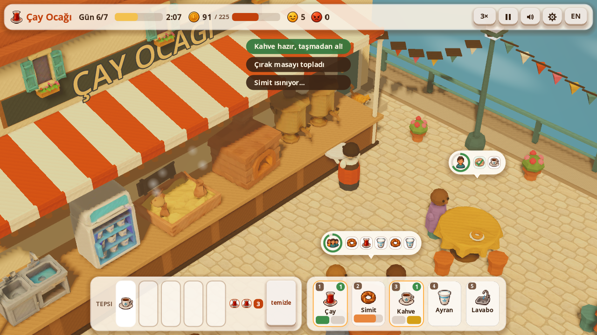

# ☕ Çay Ocağı · Tea House Rush (Godot 4)

**[▶ Play in your browser](https://furkiozknn.github.io/cay-ocagi-godot/)** · Türkçe & English · desktop & mobile · free, no install

🏟️ Part of **[Claude Game Arena](https://github.com/Furkiozknn/claude-game-arena)**, round 2: every model remakes its own
round-1 browser game in Godot 4. This one was rebuilt by **Claude Sonnet 5.5** from its Three.js original,
[Çay Ocağı](https://github.com/Furkiozknn/cay-ocagi). [See all games and the scorecard →](https://furkiozknn.github.io/claude-game-arena/)

A low-poly 3D time-management game: run a tiny tea house on an Istanbul quay for seven busy days.
Brew tea, warm simit, cook Turkish coffee without letting it boil over, serve every table before
patience runs out and keep the glasses washed. Turkish and English. The stations, tables, windows, ferry, cat,
cobblestones, icons and crest are generated assets shared with the browser version; everything else (and all sound)
is made in code.


| | |
|---|---|
|  |  |
|  |  |
|  |  |



## What is new compared with the browser version

- **Real engine, same rules.** Brew times, prices, patience, tips, the seven days, the shop and the endless
  shift are the same numbers, now loaded from `.tres` resource files (`data/`).
- **A proper look.** One shadowed sun, warm ambient light, depth fog, filmic tone mapping, merged flat-shaded meshes
  (about 40 draw calls), a shader sea, steam / smoke / sparks / hearts as `CPUParticles3D`, a smooth camera with
  pan, zoom and a small shake, an `AnimationPlayer` clip that drifts the camera on the title screen.
- **Juice.** Tween pop-ins for tables, stars and toasts, floating coin texts that follow the world, patience rings
  that shake when a customer is about to leave, hover rings on tables and stations, a cat you can pet.
- **Menus.** Title (crest, a self-playing demo day behind it, footer credit), new-game confirm, day intro, pause
  (Resume / Restart the day / Settings / Main menu over a dimmed, blurred backdrop), settings, summary with animated
  stars, shop, game over and victory, with a *New record!* badge and a Main menu button on the end cards. All cards
  animate in and work with keyboard and gamepad (the first button takes the focus, amber focus ring).
- **Settings.** Master / music / effects volume (defaults 80 / 60 / 80 %), language (TR / EN), quality (low / high,
  applied live), fullscreen. Saved to `user://settings.cfg`. The music is ducked to 45 % while paused or when the
  window is in the background.
- **Save system.** Progress (day, coins, upgrades, star log, retry flag) is saved to `user://save.json` at the start of
  every day and in the shop; the title offers *Continue*, and *New game* asks before overwriting the run. The best run
  is stored too.
- **Fair money rules (same in the browser version).** Tables that are still eating at closing time pay their bill and
  tip. A failed day keeps its coins: *Shop & retry* opens the shop, and its button then says *Retry the day*.
  The last 20 seconds are *last orders* (a toast, a bell, the clock turns red), and paid coins fly to the counter.
- **Sound.** All effects, a looping sea ambience and a hicaz-flavoured plucked tune with a frame drum are synthesised
  at start-up (`scripts/autoload/sfx.gd`), spread over frames so nothing freezes.
- **Self-tests.** A deterministic simulation (`TeaSim`) with 458 unit-test assertions, a UI smoke test with synthetic
  input (43 checks) and an autoplay bot that plays all seven days.
- **Phone friendly.** Touch drag to pan, pinch to zoom, a portrait layout and a responsive HUD.

## Controls

| Action | Mouse / keyboard | Touch | Gamepad |
|---|---|---|---|
| Use a station (brew, collect, wash) | Click it, or keys `1`-`5` | Tap the station or its button | `X` `Y` `A` `LB` `RB` (stations 1-5) |
| Serve or clear a table | Click the table or its order bubble; `Q` / `E` select, `Enter` serves | Tap | D-pad left / right select, D-pad up serves |
| Drop an item from the tray (not dirty glasses: they go to the sink) | Click the tray slot | Tap | - |
| Clear the walking queue | `Backspace` or right click | `clear` button | `B` |
| Pan / zoom | Drag / mouse wheel (or `+` `-`) | Drag / pinch | - |
| Pause / back (closes settings first) | `P`, `Esc` (or `Space`) | Pause button | `Start` |
| Speed 1x / 2x / 3x | `F` or the speed button | Speed button | `Back` |
| Music / effects on or off | `M` / `X` | Settings | - |
| Language | `L` | `EN` / `TR` button | - |
| Menus | `Tab` / arrows move, `Enter` / `Space` press | Tap | D-pad moves, `A` presses |

The waiter walks to each target in order; you can queue up to six clicks. Station and table input is ignored
while the game is paused.

## Run it

Open the folder in Godot 4.7.2 (standard build) and press F5, or from a terminal:

```
godot --path .
```

The main scene is `res://scenes/main.tscn`.

### Tests

```
godot --headless --path . --scene res://tests/run_tests.tscn     # unit tests, last line: TESTS PASSED n/n
godot --headless --path . --scene res://tests/ui_smoke.tscn      # drives the real scene with fake input
godot --headless --path . --import                               # must finish without errors
```

The test runs exit with code 0 on success and 1 on failure.

### The autoplay bot

```
godot --headless --path . -- --auto --speed=120 --quit-on-finish
```

plays the whole game (all seven days, shopping in between) and prints a result line such as
`AUTO RESULT: days_cleared=7 total_coins=1752 stars=18 ...` (`--seed=5`). With a window, `-- --auto` plays at 3x speed and
continues into the endless shift after the victory screen.

### User arguments (after `--`)

| Argument | Effect |
|---|---|
| `--auto` | The game plays itself (bot). Uses its own save file `auto_save.json`. |
| `--speed=N` | Game speed multiplier (default 1, with `--auto` 3). |
| `--seed=N` | Fixed random seed for customer spawns and the bot. |
| `--day=N` | Start a new game on day N with 150 coins per skipped day. |
| `--sim=S` | Fast-forward S game seconds of the first day without rendering. |
| `--stop=phase[:day]` | Freeze when a phase is reached: `intro`, `summary`, `shop`, `gameover`, `victory`. |
| `--skill=X` | Bot skill 0.1-2 (low values lose, for testing the game-over screen). |
| `--lang=en` / `--lang=tr` | Interface language (not saved). |
| `--low` | Low quality (no shadows, no MSAA, half the particles). |
| `--zoom=Z` / `--pan=X,Y` | Initial camera zoom and pan. |
| `--open=settings` / `pause` / `settings-pause` | Jump straight to a menu (for screenshots). |
| `--save=NAME` | Use `user://NAME.json` as the save file. |
| `--no-save` | Read and write no save file (tests, screenshots). |
| `--noassets` | Use the procedural models and vector icons instead of the generated assets. |
| `--quit-on-finish` | With `--auto`: quit with exit code 0 after the victory screen. |

`GameState.get_state_text()` returns the whole state (phase, day, coins, stations, tables, orders, tray, queue) as JSON.

### Visual check without export templates

Godot's Movie Maker renders frames with the real GPU:

```
godot --path . --write-movie out/f.png --fixed-fps 30 --quit-after 120 -- --auto --day=6 --sim=70
```

For a portrait window create a temporary `override.cfg` with `[display]` `window/size/viewport_width=390`
`window/size/viewport_height=780` (it is git-ignored).

### Web build

`export_presets.cfg` has a preset named **Web** that writes `build/web/index.html` with thread support off
(works on GitHub Pages) and VRAM compression for desktop and mobile. No editor-only step is needed:

```
godot --headless --path . --export-release "Web" build/web/index.html
```

(needs the matching export templates installed).

## Project layout

```
data/            game data as .tres: items, customers, days, upgrades, balance
scripts/data/    the Resource classes behind those files
scripts/sim/     TeaSim (all rules, no nodes), NavGrid (A*), AutoBot
scripts/autoload GameState (phases, save, --auto), Settings, Sfx (synthesised audio)
scripts/view/    3D side: world builder, mesh merger, generated models, item models, tables, people, camera, particles
scripts/ui/      HUD, order bubbles, station buttons, screens, icons (PNG with a vector fallback)
assets/          generated models (GLB), cobblestone texture, icons and crest, shared with the browser version
scenes/main.tscn the only gameplay scene
tests/           run_tests (unit), ui_smoke (synthetic input)
```

## Assets

The **models were generated with Higgsfield Tripo, shared with the browser version** (semaver, oven, coffee sand
stove, ayran fridge, sink, table, window, ferry, cat; 900-1,800 triangles each, WebP textures), processed with
glTF-Transform (pivot at the base, largest side 1). The cobblestone texture, the 20 icons and the crest / favicon were
generated with Higgsfield GPT Image. Prompts and details: [cay-ocagi/docs/assets.md](https://github.com/Furkiozknn/cay-ocagi/blob/main/docs/assets.md).

`scripts/view/asset_models.gd` bakes each GLB into one flat-shaded mesh (turned to face +X, base at y = 0) and places
it with the same transforms as the browser version; the six tables and five windows are one MultiMesh each, the
tables tinted per instance. The oven glow, the simit rings, the coffee foam and the steam / smoke emitters are moved
onto the models. If a file is missing (or with `--noassets`) the procedural part stays. The served items (tea glass,
simit plate, coffee cup, ayran cup, used glass, crumb plate) are small vertex-coloured models made in code.

## Credits

Code and sound were written for this project. The generated assets are described above; there are no other
third-party assets. The default Godot font (Open Sans) is used for text.

## How it was made

Round 2 of a series in which **every game is built by a different AI model**. Each model gets the same brief,
[`prompts/godot-remake.md`](https://github.com/Furkiozknn/claude-game-arena/blob/main/prompts/godot-remake.md):
remake your own round-1 game in Godot 4.7 (GDScript, Compatibility renderer) and make it better, not just equal.
This one was built by **Claude Sonnet 5.5** (`claude-sonnet-5-5`) with [Claude Code](https://claude.com/claude-code).
The orchestrating session re-ran the checks independently before release:

- `TESTS PASSED 386/386`, clean headless import (no errors or warnings).
- The `--auto` bot clears all seven days: `days_cleared=7 stars=19 retries=0 won=true`.
- 60 FPS at 1280x720 on High quality on an Intel UHD 620 laptop GPU.

The web build is exported on GitHub's servers by [`.github/workflows/pages.yml`](.github/workflows/pages.yml)
(pinned, checksum-verified Godot 4.7.2 and export templates) and published to GitHub Pages.

## License

Code: [MIT](LICENSE). The generated assets in `assets/` belong to the project as well.
