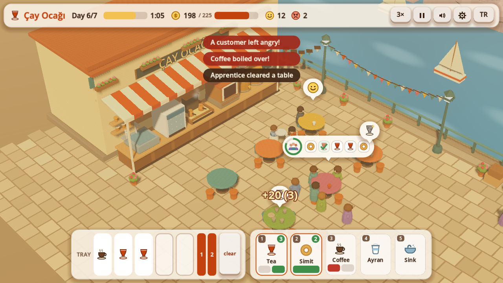
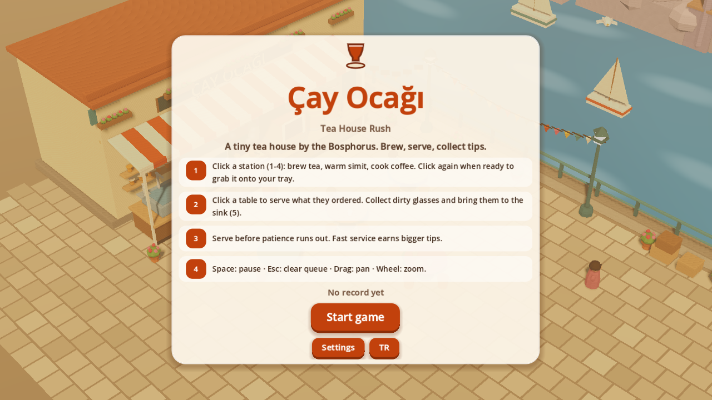
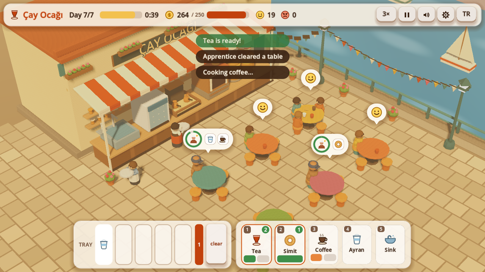
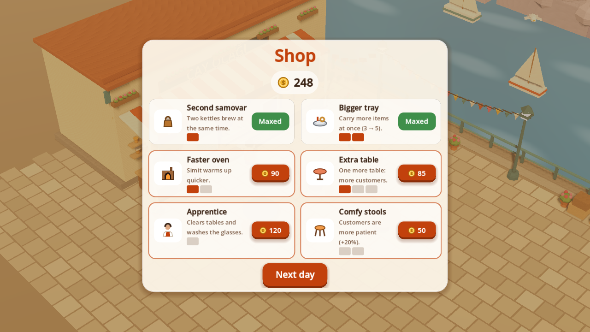
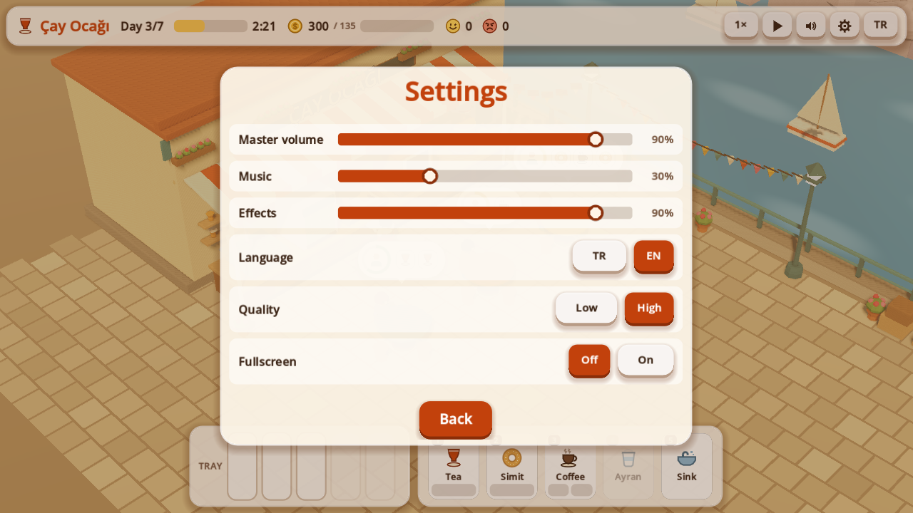
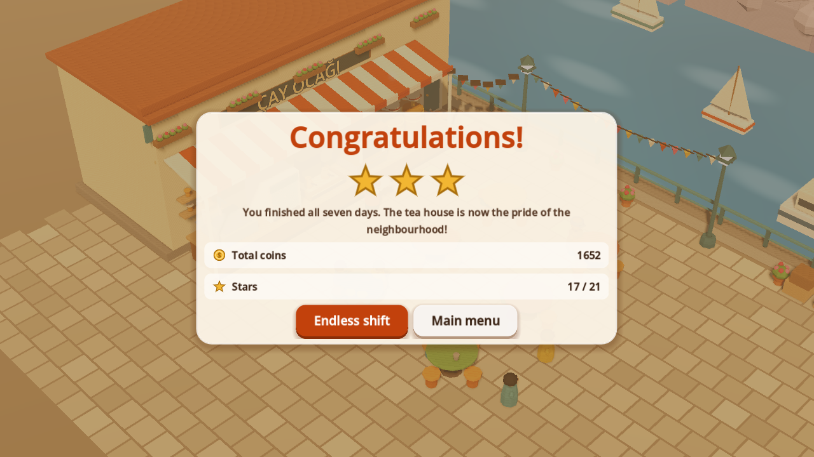
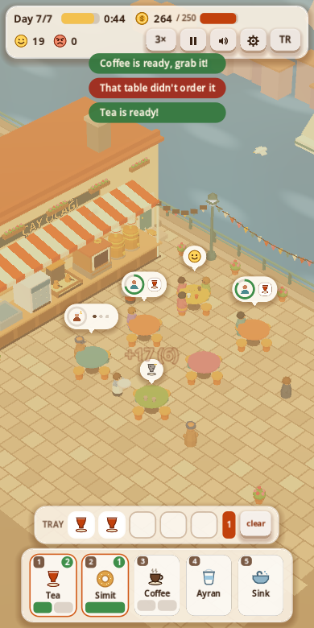

# ☕ Çay Ocağı · Tea House Rush (Godot 4)

**[▶ Play in your browser](https://furkiozknn.github.io/cay-ocagi-godot/)** · Türkçe & English · desktop & mobile · free, no install

🏟️ Part of **[Claude Game Arena](https://github.com/Furkiozknn/claude-game-arena)**, round 2: every model remakes its own
round-1 browser game in Godot 4. This one was rebuilt by **Claude Sonnet 5.5** from its Three.js original,
[Çay Ocağı](https://github.com/Furkiozknn/cay-ocagi). [See all games and the scorecard →](https://furkiozknn.github.io/claude-game-arena/)

A low-poly 3D time-management game: run a tiny tea house on an Istanbul quay for seven busy days.
Brew tea, warm simit, cook Turkish coffee without letting it boil over, serve every table before
patience runs out and keep the glasses washed. Turkish and English. Every mesh, icon and sound is generated in code.



| | |
|---|---|
|  |  |
|  |  |
|  |  |

## What is new compared with the browser version

- **Real engine, same rules.** Brew times, prices, patience, tips, the seven days, the shop and the endless
  shift are the same numbers, now loaded from `.tres` resource files (`data/`).
- **A proper look.** One shadowed sun, warm ambient light, depth fog, filmic tone mapping, merged flat-shaded meshes
  (about 40 draw calls), a shader sea, steam / smoke / sparks / hearts as `CPUParticles3D`, a smooth camera with
  pan, zoom and a small shake, an `AnimationPlayer` clip that drifts the camera on the title screen.
- **Juice.** Tween pop-ins for tables, stars and toasts, floating coin texts that follow the world, patience rings
  that shake when a customer is about to leave, hover rings on tables and stations, a cat you can pet.
- **Menus.** Title (with a self-playing demo day behind it), day intro, pause, settings, summary with animated stars,
  shop, game over and victory. All cards animate in.
- **Settings.** Master / music / effects volume, language (TR / EN), quality (low / high), fullscreen. Saved to
  `user://settings.cfg`.
- **Save system.** Progress (day, coins, upgrades, star log) is saved to `user://save.json` at the start of every day
  and in the shop; the title offers *Continue*. The best run is stored too.
- **Sound.** All effects, a looping sea ambience and a hicaz-flavoured plucked tune with a frame drum are synthesised
  at start-up (`scripts/autoload/sfx.gd`), spread over frames so nothing freezes.
- **Self-tests.** A deterministic simulation (`TeaSim`) with 386 unit-test assertions, a UI smoke test with synthetic
  input and an autoplay bot that plays all seven days.
- **Phone friendly.** Touch drag to pan, pinch to zoom, a portrait layout and a responsive HUD.

## Controls

| Action | Mouse / keyboard | Touch | Gamepad |
|---|---|---|---|
| Use a station (brew, collect, wash) | Click it, or keys `1`-`5` | Tap the station or its button | `X` `Y` `A` `LB` `RB` (stations 1-5) |
| Serve or clear a table | Click the table or its order bubble; `Q` / `E` select, `Enter` serves | Tap | D-pad left / right select, D-pad up serves |
| Drop an item from the tray | Click the tray slot | Tap | - |
| Clear the walking queue | `Esc` or right click | `clear` button | `B` |
| Pan / zoom | Drag / mouse wheel (or `+` `-`) | Drag / pinch | - |
| Pause | `Space` or `P` | Pause button | `Start` |
| Speed 1x / 2x / 3x | `F` or the speed button | Speed button | `Back` |

The waiter walks to each target in order; you can queue up to six clicks.

## Run it

Open the folder in Godot 4.7.2 (standard build) and press F5, or from a terminal:

```
godot --path .
```

The main scene is `res://scenes/main.tscn`.

### Tests

```
godot --headless --path . --scene res://tests/run_tests.tscn     # unit tests, last line: TESTS PASSED n/n
godot --headless --path . --scene res://tests/ui_smoke.tscn      # drives the real scene with fake input
godot --headless --path . --import                               # must finish without errors
```

The test runs exit with code 0 on success and 1 on failure.

### The autoplay bot

```
godot --headless --path . -- --auto --speed=120 --quit-on-finish
```

plays the whole game (all seven days, shopping in between) and prints a result line such as
`AUTO RESULT: days_cleared=7 total_coins=1652 stars=17 ...`. With a window, `-- --auto` plays at 3x speed and
continues into the endless shift after the victory screen.

### User arguments (after `--`)

| Argument | Effect |
|---|---|
| `--auto` | The game plays itself (bot). Uses its own save file `auto_save.json`. |
| `--speed=N` | Game speed multiplier (default 1, with `--auto` 3). |
| `--seed=N` | Fixed random seed for customer spawns and the bot. |
| `--day=N` | Start a new game on day N with 150 coins per skipped day. |
| `--sim=S` | Fast-forward S game seconds of the first day without rendering. |
| `--stop=phase[:day]` | Freeze when a phase is reached: `intro`, `summary`, `shop`, `gameover`, `victory`. |
| `--skill=X` | Bot skill 0.1-2 (low values lose, for testing the game-over screen). |
| `--lang=en` / `--lang=tr` | Interface language (not saved). |
| `--low` | Low quality (no shadows, no MSAA, half the particles). |
| `--zoom=Z` / `--pan=X,Y` | Initial camera zoom and pan. |
| `--open=settings` / `pause` / `settings-pause` | Jump straight to a menu (for screenshots). |
| `--save=NAME` | Use `user://NAME.json` as the save file. |
| `--quit-on-finish` | With `--auto`: quit with exit code 0 after the victory screen. |

`GameState.get_state_text()` returns the whole state (phase, day, coins, stations, tables, orders, tray, queue) as JSON.

### Visual check without export templates

Godot's Movie Maker renders frames with the real GPU:

```
godot --path . --write-movie out/f.png --fixed-fps 30 --quit-after 120 -- --auto --day=6 --sim=70
```

For a portrait window create a temporary `override.cfg` with `[display]` `window/size/viewport_width=390`
`window/size/viewport_height=780` (it is git-ignored).

### Web build

`export_presets.cfg` has a preset named **Web** that writes `build/web/index.html` with thread support off
(works on GitHub Pages) and VRAM compression for desktop and mobile. No editor-only step is needed:

```
godot --headless --path . --export-release "Web" build/web/index.html
```

(needs the matching export templates installed).

## Project layout

```
data/            game data as .tres: items, customers, days, upgrades, balance
scripts/data/    the Resource classes behind those files
scripts/sim/     TeaSim (all rules, no nodes), NavGrid (A*), AutoBot
scripts/autoload GameState (phases, save, --auto), Settings, Sfx (synthesised audio)
scripts/view/    3D side: world builder, mesh merger, tables, people, camera rig, particles
scripts/ui/      HUD, order bubbles, station buttons, screens, vector icons
scenes/main.tscn the only gameplay scene
tests/           run_tests (unit), ui_smoke (synthetic input)
```

## Credits

Everything here, code, meshes and sound, was written for this project; there are no third-party assets.
The default Godot font (Open Sans) is used for text.

## How it was made

Round 2 of a series in which **every game is built by a different AI model**. Each model gets the same brief,
[`prompts/godot-remake.md`](https://github.com/Furkiozknn/claude-game-arena/blob/main/prompts/godot-remake.md):
remake your own round-1 game in Godot 4.7 (GDScript, Compatibility renderer) and make it better, not just equal.
This one was built by **Claude Sonnet 5.5** (`claude-sonnet-5-5`) with [Claude Code](https://claude.com/claude-code).
The orchestrating session re-ran the checks independently before release:

- `TESTS PASSED 386/386`, clean headless import (no errors or warnings).
- The `--auto` bot clears all seven days: `days_cleared=7 stars=19 retries=0 won=true`.
- 60 FPS at 1280x720 on High quality on an Intel UHD 620 laptop GPU.

The web build is exported on GitHub's servers by [`.github/workflows/pages.yml`](.github/workflows/pages.yml)
(pinned, checksum-verified Godot 4.7.2 and export templates) and published to GitHub Pages.

## License

Code: [MIT](LICENSE). No third-party assets.
